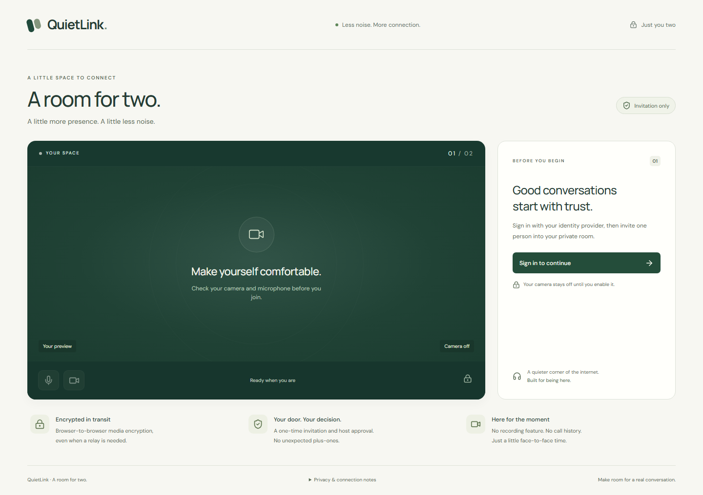
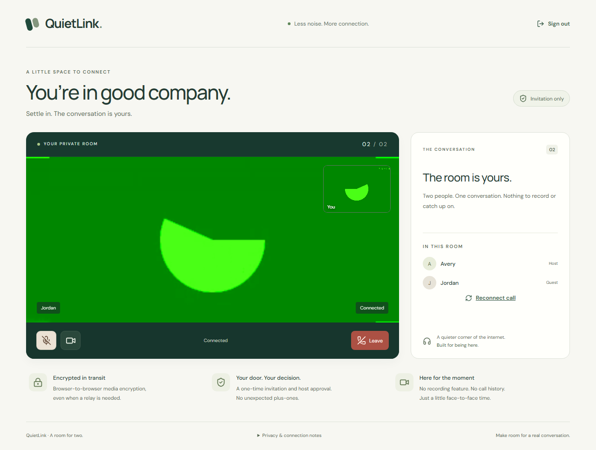

# QuietLink

**A room for two.** Invitation-only video calls with OIDC identity, explicit host approval and browser-to-browser WebRTC media.



## What it does

- Sign in through one configured OpenID Connect provider using authorization code flow, PKCE, state and nonce.
- Preview camera and microphone before entering a room.
- Share an expiring, single-use invitation. The host accepts or declines the guest; room admission is atomically limited to two participants.
- Exchange video and audio directly between browsers, with optional configured TURN fallback.
- Mute, toggle camera, reconnect and leave. Leaving stops local media tracks; host departure closes the room.
- Use a responsive interface with keyboard controls, named controls, live connection status and tested contrast.

Go `net/http` owns authentication, opaque sessions, room access and WebSocket signaling. React and TypeScript own the browser interface and WebRTC lifecycle. There is no SFU, recording feature or custom cryptography.

## Run locally

Requirements: Go **1.27.2+**, Node.js **24+**, npm.

```sh
npm ci
npm run build
npm run dev
```

Open **http://127.0.0.1:8080** in two separate browser profiles. Sign in as Avery and Jordan through the local test identity provider. Enable devices, create a room, share its invitation, request entry and accept the guest. Set `GO_BIN` to your Go executable path if it is not on PATH.

The local provider runs separately on loopback port 9090 and visibly labels its test identities. It does not authenticate real accounts. The production configuration rejects its reserved client ID. No external accounts, OAuth credentials or public deployment are included.

For a real provider, HTTPS deployment and TURN configuration, see [operations](docs/operations.md). Environment variables are listed in [.env.example](.env.example); they are not automatically loaded from a file.

## Security and limits

Media uses standard browser DTLS-SRTP encryption between peers, including when TURN relays packets. The Go server does not terminate media. The web origin, signaling service and identity provider remain trusted; OIDC login does not independently bind identities to media fingerprints. Peers may learn each other's IP addresses, and participants can record using external tools.

Sessions, rooms and invitations live in process memory. Run one instance; restart clears state. Sessions last eight hours, rooms two hours and invitations ten minutes. A new invitation invalidates the previous link. Signaling has membership checks, exact Origin checks, bounded queues, size/rate limits and negotiation generations that discard stale reconnect messages. HTTP mutations also require a session CSRF token.

Each OIDC identity may hold up to five sessions and occupy one room (including pending admission). Login starts are limited to 60 per five-minute window per transport IP or IPv6 /64. Behind a reverse proxy this quota is shared by clients using that proxy; forwarded headers are deliberately not trusted. HTTPS uses `__Host-` session and login cookies; upgrading from older cookie names requires signing in again.

There is no default external STUN/TURN service. Restricted networks may need an operator-configured relay, with network access and bandwidth costs. Real-provider and cross-network TURN checks have not been performed. Read the full [trust model](docs/security.md) and [architecture decisions](docs/architecture.md).

## Verification

```sh
go vet ./cmd/... ./internal/...
go test ./cmd/... ./internal/...
go test -race ./cmd/... ./internal/...
npm run lint
npm run typecheck
npm run build
npx playwright install chromium
npm run test:e2e
```

The suite covers Go authentication, quotas, cookie ambiguity, room access and signaling, plus nineteen Playwright tests. Call and recovery browser tests use the real Go backend and local OIDC provider with isolated browser contexts and fake media. They verify received video, admission, reconnect, media controls, stopped tracks on leave, rejected/replayed invitations, responsive layouts and automated accessibility checks. Recovery regressions discard real create/join responses after the server commits, then verify retry and refresh; transient restoration failures preserve the saved room. Seven lifecycle regressions use controlled browser API and HTTP doubles to delay camera permission and negotiation across room/session termination, socket close, reset and queue overflow. Resets also work when the old peer operation never settles, and late old completions cannot unlock the new queue. Automated checks are not a substitute for manual assistive-technology testing.

The [CI workflow](.github/workflows/ci.yml) runs the race detector on Linux, where a C toolchain is available. Local Windows race execution requires a separately installed C compiler. The latest repository check result is the source of truth for CI status.



The call screenshot uses Chromium's synthetic camera input; it is a local test, not a real-device or cross-network demonstration.

## Publication status

Source checks and a production deployment are separate milestones. See the [release checklist](docs/release.md) for remaining decisions. No project license has been selected; repository visibility alone does not grant an open-source license.
